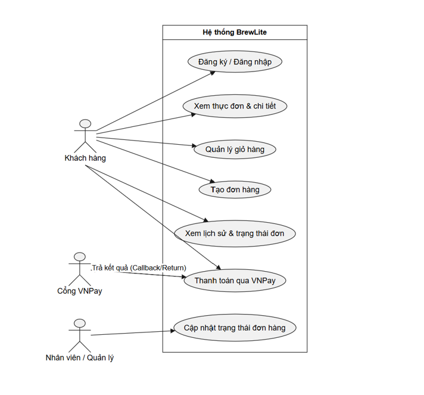

# SRS rút gọn (Task 1.2)

## 1. Yêu cầu chức năng
| Mã | Tên chức năng | MoSCoW | Mô tả ngắn | Tiêu chí chấp nhận |
|---|---|---|---|---|
| FR-01 | Xem menu sản phẩm | Must have | Hiển thị danh sách sản phẩm theo danh mục (cà phê, trà, bánh ngọt...) |  - Trả về danh sách sản phẩm từ database. - Hỗ trợ phân trang hoặc lọc theo danh mục.  - Có trạng thái loading và xử lý lỗi khi mất kết nối. |
| FR-02 | Xem chi tiết sản phẩm | Must have | Xem thông tin chi tiết, hình ảnh, giá tiền và các tuỳ chọn size/topping |  - Hiển thị đúng thông tin của một sản phẩm khi click vào. - Cho phép chọn size (S/M/L) và topping kèm theo.|
| FR-03 | Quản lý giỏ hàng | Must have | Cho phép khách hàng thêm, sửa số lượng, xóa sản phẩm khỏi giỏ hàng tạm thời. |  - Cập nhật tổng tiền động ngay khi thay đổi số lượng. - Dữ liệu giỏ hàng được lưu trữ ổn định trên client |
| FR-04 | Xác thực tài khoản | Must have | Đăng ký tài khoản mới, đăng nhập và cấp phát JWT Token |  - Kiểm tra định dạng email và độ mạnh mật khẩu. - Trả về JWT Access Token sau khi đăng nhập thành công |
| FR-05 | Đặt đơn và thanh toán | Must have | Tạo đơn hàng mới từ giỏ hàng và tích hợp chuyển hướng sang cổng thanh toán VNPay |  - Tạo bản ghi Order và OrderItem trong DB. - Sinh ra paymentUrl chính xác từ VNPay sandbox với chữ ký an toàn (checksum) |
| FR-06 | Lịch sử và trạng thái đơn | Should have | Cho phép khách hàng theo dõi lịch sử các đơn hàng đã đặt và trạng thái hiện tại |  - Hiển thị danh sách đơn hàng đã mua của user đang đăng nhập. - Cập nhật đúng trạng thái (PENDING, PAID, CANCELED) |

## 2. Yêu cầu phi chức năng
| Mã yêu cầu | Loại | Tiêu chí chấp nhận |
|---|---|---|
| NFR-01 | Hiệu năng | Thời gian phản hồi của các API thông thường (như lấy danh mục, chi tiết sản phẩm) dưới $500\text{ms}$ dưới tải thông thường |
| NFR-02 | Bảo mật | Mật khẩu người dùng bắt buộc được mã hóa bằng bcrypt trước khi lưu trữ vào PostgreSQL; các API nhạy cảm yêu cầu bắt buộc xác thực bằng Bearer JWT |
| NFR-03 | Khả dụng | Giao diện Next.js được thiết kế theo chuẩn mobile-first / PWA, hiển thị mượt mà trên cả thiết bị di động lẫn máy tính |
| NFR-04 | Khả năng triển khai | Hệ thống phải dễ dàng đóng gói qua Docker và chạy đồng bộ ở cả môi trường local (thông qua docker-compose) lẫn production |

## 3. Use-case tổng quát
- Actors chính: Khách hàng (Customer), Nhân viên quầy (Staff), Quản lý (Manager), Cổng thanh toán VNPay.
- Tóm tắt: Sơ đồ bao quát toàn bộ các ca sử dụng từ việc Khách hàng duyệt menu, quản lý giỏ hàng, xác thực tài khoản, thực hiện thanh toán VNPay, cho đến việc Nhân viên/Quản lý xử lý trạng thái đơn hàng trong hệ thống BrewLite.

