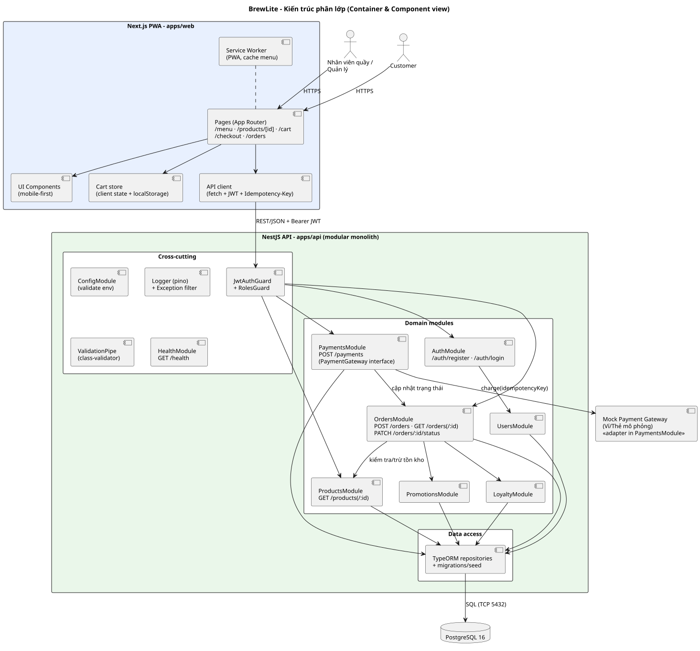

# Mô tả kiến trúc (Task 3.1)

Tài liệu mô tả kiến trúc đề xuất cho BrewLite theo **kiến trúc phân lớp** kết hợp góc nhìn container (C4 mức 2–3). Các quyết định quan trọng được ghi thành ADR trong [`adr/`](adr).

## 1. Mục tiêu và ràng buộc kiến trúc
- Chạy được luồng: Xem menu → Tuỳ chọn → Giỏ hàng → Đặt đơn → Thanh toán → Theo dõi đơn.
- Bắt buộc: Next.js, NestJS, PostgreSQL, Docker.
- Chất lượng ưu tiên: đúng đắn dữ liệu đơn/tồn kho, bảo mật (JWT, secret), khả năng triển khai tự động, dễ test.
- Ràng buộc: nhóm nhỏ, hai sprint, chi phí thấp.

## 2. Tổng quan

Nguồn: [`architecture-container.puml`](../diagrams/architecture-container.puml). Sơ đồ triển khai: [`deployment-production.svg`](../diagrams/deployment-production.svg).

## 3. Các thành phần

### 3.1 Frontend – Next.js / PWA (`apps/web`)
| Lớp | Nội dung |
|---|---|
| Pages (App Router) | `/menu`, `/products/[id]`, `/cart`, `/checkout`, `/orders`, `/login` |
| UI components | Component mobile-first, trạng thái loading/empty/error |
| Cart store | State giỏ hàng + `localStorage` ([ADR-009](adr/009-nextjs-pwa-client-cart.md)) |
| API client | Gắn JWT, sinh `Idempotency-Key`, chuẩn hoá lỗi |
| Service Worker | Manifest + cache để cài đặt PWA |

### 3.2 Backend – NestJS theo module (`apps/api`)
Theo [ADR-002](adr/002-modular-monolith-layered.md): controller → service → repository.

| Module | Trách nhiệm | Endpoint chính |
|---|---|---|
| Auth / Users | Đăng ký, đăng nhập, JWT, vai trò | `POST /auth/register`, `POST /auth/login` |
| Products | Menu, chi tiết, size, topping, tồn kho | `GET /products`, `GET /products/:id` |
| Orders | Tạo đơn (transaction), trạng thái, lịch sử | `POST /orders`, `GET /orders`, `PATCH /orders/:id/status` |
| Payments | Thanh toán mô phỏng, idempotency | `POST /payments` |
| Promotions / Loyalty | Khuyến mãi, tích điểm | dùng nội bộ trong luồng đặt đơn |
| Health | Liveness + kiểm tra DB | `GET /health` |

Cross-cutting: ConfigModule (validate env), logger pino, ValidationPipe, JwtAuthGuard/RolesGuard, exception filter ([ADR-008](adr/008-observability-config.md)).

### 3.3 Cơ sở dữ liệu và migration
- PostgreSQL 16, TypeORM, `synchronize: false`, migration + seed có version ([ADR-003](adr/003-postgresql-typeorm-migrations.md)).
- Tạo đơn và trừ tồn kho trong một transaction, khoá hàng chống bán quá tồn.
- Migration chạy khi container API khởi động, theo mô hình expand/contract ([ADR-007](adr/007-migration-rollback-strategy.md)).

### 3.4 Dịch vụ thanh toán mô phỏng
`PaymentGateway` interface + `MockPaymentGateway`; idempotency bằng `UNIQUE(idempotency_key)` ([ADR-005](adr/005-mock-payment-idempotency.md)).

### 3.5 Logging, health check, cấu hình
Xem [ADR-008](adr/008-observability-config.md): log JSON ra stdout, `GET /health`, validate biến môi trường lúc khởi động.

## 4. Lý do chọn, ưu điểm, hạn chế, trade-off

| Quyết định | Ưu điểm | Hạn chế | Trade-off chấp nhận |
|---|---|---|---|
| Modular monolith | Đơn giản vận hành, transaction dễ | Scale theo khối | Đổi lấy tốc độ phát triển 2 sprint |
| Monorepo | Truy vết code–docs–test dễ | CI chậm dần khi lớn | Dùng matrix + cache |
| PostgreSQL + migration | ACID, tái tạo schema | Cần kỷ luật migration | Không dùng `synchronize` |
| JWT access token | Stateless | Khó thu hồi tức thì | Token ngắn hạn, refresh để sau |
| Giỏ hàng client | Không cần đăng nhập, ít bảng | Không đồng bộ đa thiết bị | Server tính lại giá khi đặt đơn |
| Mock payment | Test xác định được | Không mô phỏng mạng thật | Interface cho phép thay cổng thật |
| Render + GHCR + Docker | HTTPS, DB private, rollback bằng tag | Phụ thuộc nhà cung cấp, cold start (free) | Nhóm có thể đổi nền tảng, cập nhật ADR-006 |

## 5. Truy vết thành phần triển khai → kiến trúc → mã nguồn

| Thành phần trong deployment diagram | Thành phần kiến trúc | Mã nguồn / cấu hình |
|---|---|---|
| Trình duyệt / PWA + Service Worker | Frontend – Service Worker | `apps/web/public/manifest.json`, `apps/web/src/sw*` |
| Render Edge (TLS, CDN) | Hạ tầng nền tảng (không có mã) | Cấu hình Render, [`docs/deployment.md`](../deployment.md) |
| Container `brewlite-web` | Frontend – Next.js | `apps/web/` + `apps/web/Dockerfile` |
| Container `brewlite-api` | Backend – NestJS modules | `apps/api/` + `apps/api/Dockerfile` |
| `GET /health` | HealthModule | `apps/api/src/health/` |
| Render PostgreSQL | CSDL + migration | `apps/api/src/migrations/`, `apps/api/src/seed/` |
| Environment variables | ConfigModule | `.env.example`, `apps/api/src/config/` |
| GitHub Actions runner | CI/CD | `.github/workflows/ci.yml`, `cd.yml` |
| GHCR | Container registry | Bước `docker/build-push-action` trong `cd.yml` |
| Docker Compose (local) | Môi trường local | `docker-compose.yml` |

> Các đường dẫn `apps/...` sẽ xuất hiện khi hiện thực ở Sprint 1–2; cập nhật bảng này nếu cấu trúc thư mục thay đổi.

## 6. Danh sách ADR
| ADR | Tiêu đề |
|---|---|
| [001](adr/001-monorepo.md) | Monorepo |
| [002](adr/002-modular-monolith-layered.md) | Kiến trúc phân lớp, modular monolith |
| [003](adr/003-postgresql-typeorm-migrations.md) | PostgreSQL + TypeORM + migration |
| [004](adr/004-jwt-authentication.md) | Xác thực JWT |
| [005](adr/005-mock-payment-idempotency.md) | Thanh toán mô phỏng + idempotency |
| [006](adr/006-docker-ghcr-render.md) | Docker, GHCR, Render |
| [007](adr/007-migration-rollback-strategy.md) | Migration an toàn và rollback |
| [008](adr/008-observability-config.md) | Logging, health, config |
| [009](adr/009-nextjs-pwa-client-cart.md) | Next.js PWA, giỏ hàng client |
